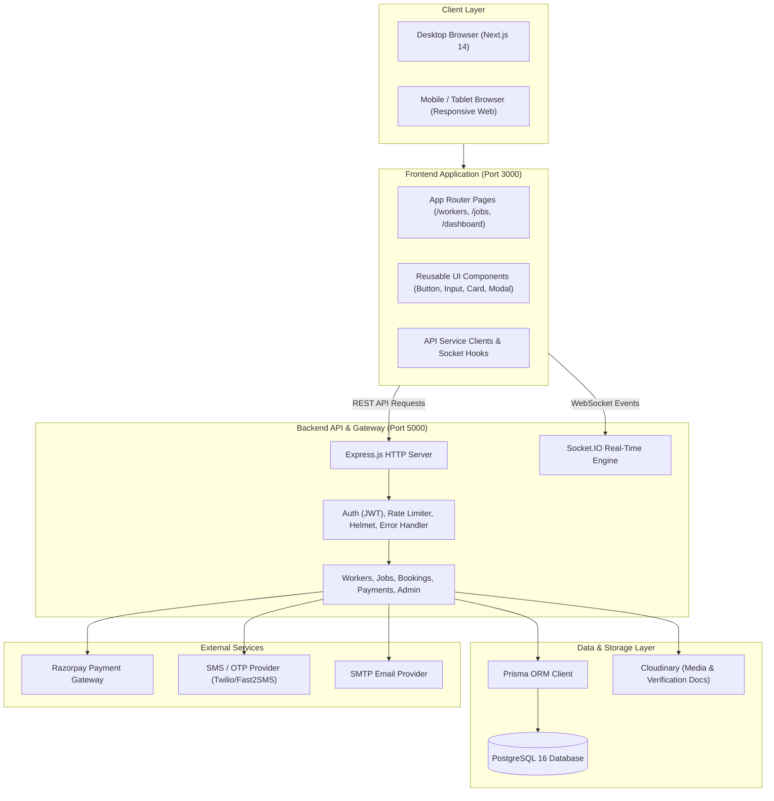

# MajDur Architecture & System Topology

**Author:** Harsh Singh  
**Platform:** MajDur (India's Premier Workforce Marketplace)

---

## 1. Architectural Blueprint

---

## 2. Directory Layout & Boundaries

- **`frontend/`**: Handles all user-facing presentation, client state, server-side rendering, responsive layouts, accessibility, and theme tokens (`#101010` dark theme, `#D4AF37` accent).
- **`backend/`**: Encapsulates database access, business rules, token issuance, password hashing, payment webhook validation, real-time message broadcasting, and administrative authorization.
- **`backend/prisma/`**: Single source of truth for the database schema containing 24 relational models.
- **`docs/`**: Technical contracts, data dictionaries, security policies, and deployment blueprints.

