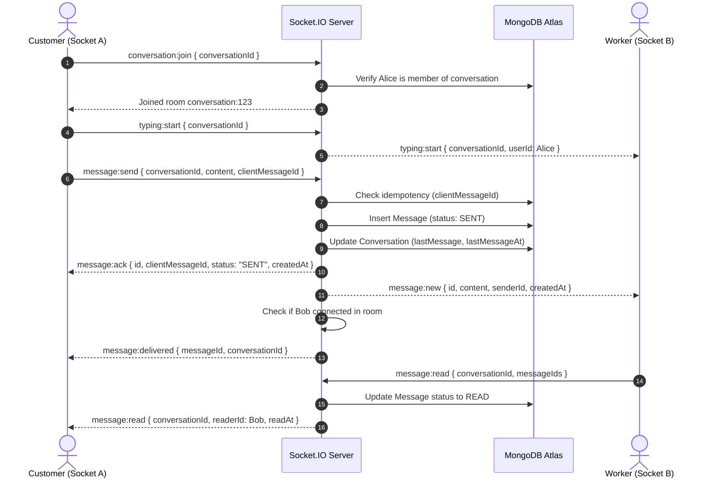
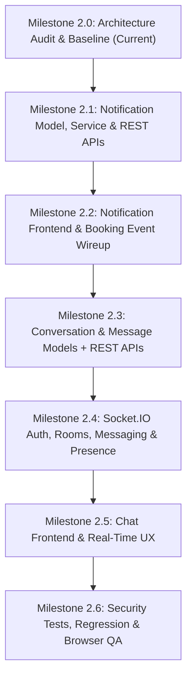

# MajDur (मजदूर) — Phase 8 Stage 2: Architecture Audit & Implementation Plan
**Notifications Engine + Real-Time Chat System**

> **Project:** MAJDUR (मजदूर) — *Find Work. Hire Workers. Build Your Future.*  
> **Platform:** Google Antigravity  
> **Workspace:** `D:\MajDur`  
> **Audited Date:** November 15, 2026  
> **Audit Author:** Senior Full-Stack Software Architect & Security Engineer  
> **Scope:** Milestone 2.0 Architectural Review & Technical Blueprint  

---

## 1. Executive Summary & Objective

This document establishes the architectural baseline, technical specifications, and execution roadmap for **MajDur Phase 8 Stage 2**:
1. **Module A — Notifications Engine:** Robust in-app notifications lifecycle integrated across bookings, reviews, and messaging with MongoDB persistence, real-time push, unread badges, and responsive UI components.
2. **Module B — Real-Time Chat System:** Secure one-to-one messaging between Customers and Workers (and authorized Contractors/Admins), linked to booking contracts where applicable, persisted in MongoDB, powered by Socket.IO with strict JWT authentication, server-managed rooms, delivery/read receipts, typing indicators, and multi-tab online presence.

### Strict Scope Boundaries
- **Preserve Phase 1–8 Stage 1:** All completed marketplace discovery, 32 trade categories, search filters (category, city, pincode, rate, rating, experience), booking lifecycle (8 states), invoices, and reviews must remain untouched and fully regression-tested.
- **Phase 9 Prohibited:** Zero payment integrations (no Razorpay, no wallets, no refunds).
- **Out of Scope Prohibited:** No media/file attachments, voice/video calls, group chats, SMS/WhatsApp integrations, or AI chatbot overlays.

---

## 2. Current Architecture & System Inventory

### 2.1 Monorepo & Technology Stack
| Layer | Existing Technology | Configuration & Notes |
|---|---|---|
| **Backend Runtime** | Node.js v24.16.0 / Express v4.21.2 | TypeScript 5.7, ES2022 target, compiled via `tsc` to `dist/` |
| **Database** | MongoDB Atlas Hosted Replica Set | Prisma ORM 5.22.0 (`@prisma/client`), MongoDB object IDs (`@map("_id") @db.ObjectId`) |
| **Authentication** | Dual-mode JWT (HTTP-only Cookie + Authorization Bearer) | `majdur_access_token` (15m expiry), `majdur_refresh_token` (7d expiry in `RefreshSession`) |
| **Frontend Framework** | Next.js 14.2.24 (App Router) | React 18.3.1, Tailwind CSS 3.4.17, Lucide React 0.475.0, Framer Motion 11.18.2 |
| **Real-Time Engine** | Socket.IO Server v4.8.1 | Installed in backend, mounted on Express `http.createServer(app)`. **Frontend client (`socket.io-client`) not yet installed.** |
| **Design System** | Premium MajDur Dark/Gold Theme | `#0d0d0d` background, `#141414` / `#1c1c1c` surfaces, `#D4AF37` gold accents |

### 2.2 Existing User & Booking Models
- **`User` Model:** Stores `id`, `name`, `phone`, `email`, `role` (`CUSTOMER`, `WORKER`, `CONTRACTOR`, `ADMIN`), `avatar`, verification flags, and profile relations.
- **`CustomerProfile` & `WorkerProfile`:** Separated 1-to-1 profile tables containing metadata, location, ratings, daily/hourly rates, and completed jobs.
- **`Booking` Model:** Manages customer-worker hiring contracts with `bookingNumber` (`MD-YYYY-XXXXXX`), `serviceCategory`, `status` (`REQUESTED`, `ACCEPTED`, `REJECTED`, `CONFIRMED`, `IN_PROGRESS`, `COMPLETED`, `CANCELLED`, `DISPUTED`), rates, dates, and `statusHistory`.

---

## 3. Gap Analysis: Notifications & Messaging

### 3.1 Notifications Current State vs. Target State
| Dimension | Current Implementation | Target Stage 2 Implementation |
|---|---|---|
| **Database Model** | `Notification` has `id`, `userId`, `title`, `message`, `type`, `isRead`, `link`, `createdAt`. | Add `bookingId`, `conversationId`, `relatedUserId`, `readAt`, `updatedAt`, and index `[userId, createdAt]`. |
| **Backend Service** | Direct ad-hoc `prisma.notification.create` calls scattered inside `bookings.routes.ts` and `reviews.routes.ts`. | Centralized `notification.service.ts` with safe failure handling, deduplication, and Socket.IO emission. |
| **REST APIs** | `GET /api/notifications`, `PATCH /api/notifications/:id/read`, `PATCH /api/notifications/read-all`. | Add `GET /api/notifications/unread-count`, `DELETE /api/notifications/:id`, pagination (`page`, `limit`), filter `unread=true`. |
| **Frontend UI** | Isolated `/dashboard/customer/notifications` page. | Global `NotificationBell` with live unread badge in Navbar, `NotificationDropdown` preview, universal `/dashboard/notifications` history page, and real-time toaster. |

### 3.2 Chat & Real-Time Engine Current State vs. Target State
| Dimension | Current Implementation | Target Stage 2 Implementation |
|---|---|---|
| **Prisma Models** | Minimal `Conversation`, `ConversationMember`, `Message` defined but unused in routes. | Enhanced `Conversation` (with `bookingId`, `lastMessage`, `lastMessageAt`) and `Message` (with `messageType`, `status`, `clientMessageId`, `readAt`, `updatedAt`). |
| **Socket.IO Backend** | Stub `chatSocket.ts` with no authentication, trusted `senderId`, and in-memory broadcasting. | Production-grade `chatSocket.ts` with JWT handshake middleware, strict participant room verification (`conversation:<id>`), database persistence prior to broadcast, typing throttling, and presence management. |
| **REST APIs** | None exist for conversations or messages. | Comprehensive REST suite (`POST /api/conversations`, `GET /api/conversations`, `GET /api/conversations/:id`, `GET /api/conversations/:id/messages`, `POST /api/conversations/:id/messages`, `PATCH /api/conversations/:id/read`). |
| **Frontend Client** | No `socket.io-client` dependency; no messaging pages. | Install `socket.io-client`; build `/dashboard/messages` & `/dashboard/messages/[conversationId]`, `useSocket` hook, message bubbles, composer, typing status, presence dots, and read checks. |

---

## 4. Database Schema Enhancement Plan

Prisma with MongoDB requires careful schema management (avoiding unsupported relational features while leveraging Mongo document IDs).

### 4.1 Enhanced `Notification` Model
```prisma
enum NotificationType {
  BOOKING_REQUEST
  BOOKING_ACCEPTED
  BOOKING_REJECTED
  BOOKING_CANCELLED
  WORK_STARTED
  WORK_COMPLETED
  NEW_MESSAGE
  NEW_REVIEW
  INVOICE_AVAILABLE
  SYSTEM
}

model Notification {
  id             String           @id @default(auto()) @map("_id") @db.ObjectId
  userId         String           @db.ObjectId
  user           User             @relation(fields: [userId], references: [id], onDelete: Cascade)
  title          String
  message        String
  type           NotificationType @default(SYSTEM)
  isRead         Boolean          @default(false)
  readAt         DateTime?
  link           String?
  bookingId      String?          @db.ObjectId
  conversationId String?          @db.ObjectId
  relatedUserId  String?          @db.ObjectId
  createdAt      DateTime         @default(now())
  updatedAt      DateTime         @updatedAt

  @@index([userId, isRead])
  @@index([userId, createdAt])
}
```
*Backward Compatibility:* Field `userId` is retained so existing queries in `bookings.routes.ts` remain 100% operational.

### 4.2 Enhanced `Conversation` Model
```prisma
model Conversation {
  id            String               @id @default(auto()) @map("_id") @db.ObjectId
  title         String?
  bookingId     String?              @unique @db.ObjectId // Optional 1:1 link to Booking
  booking       Booking?             @relation(fields: [bookingId], references: [id], onDelete: SetNull)
  lastMessage   String?
  lastMessageAt DateTime?
  members       ConversationMember[]
  messages      Message[]
  createdAt     DateTime             @default(now())
  updatedAt     DateTime             @updatedAt

  @@index([bookingId])
  @@index([updatedAt])
}
```

### 4.3 Enhanced `ConversationMember` Model
```prisma
model ConversationMember {
  id             String       @id @default(auto()) @map("_id") @db.ObjectId
  conversationId String       @db.ObjectId
  conversation   Conversation @relation(fields: [conversationId], references: [id], onDelete: Cascade)
  userId         String       @db.ObjectId
  user           User         @relation(fields: [userId], references: [id], onDelete: Cascade)
  lastReadAt     DateTime?
  joinedAt       DateTime     @default(now())

  @@unique([conversationId, userId])
  @@index([userId])
}
```

### 4.4 Enhanced `Message` Model
```prisma
enum MessageStatus {
  SENT
  DELIVERED
  READ
}

model Message {
  id              String        @id @default(auto()) @map("_id") @db.ObjectId
  conversationId  String        @db.ObjectId
  conversation    Conversation  @relation(fields: [conversationId], references: [id], onDelete: Cascade)
  senderId        String        @db.ObjectId
  sender          User          @relation(fields: [senderId], references: [id], onDelete: Cascade)
  content         String
  messageType     String        @default("TEXT")
  status          MessageStatus @default(SENT)
  clientMessageId String?       // Scoped idempotency key
  readAt          DateTime?
  createdAt       DateTime      @default(now())
  updatedAt       DateTime      @updatedAt

  @@index([conversationId, createdAt])
  @@index([senderId, createdAt])
  @@index([clientMessageId])
}
```

---

## 5. API Specification Plan

All endpoints will enforce JWT authentication (`authenticateUser`), validate inputs using Zod or explicit sanity checks, and return the standard JSON envelope:
```json
{
  "success": true,
  "message": "...",
  "data": { ... }
}
```

### 5.1 Notifications REST Endpoints
| HTTP Method | Route | Description | Auth & Access |
|---|---|---|---|
| `GET` | `/api/notifications` | Paginated notifications list (`?page=1&limit=20&unreadOnly=false`) | Authenticated (Self only) |
| `GET` | `/api/notifications/unread-count` | Quick counter of unread notifications | Authenticated (Self only) |
| `PATCH` | `/api/notifications/:id/read` | Mark individual notification as read (sets `isRead: true`, `readAt: now`) | Authenticated (Owner only) |
| `PATCH` | `/api/notifications/read-all` | Mark all unread notifications of user as read | Authenticated (Self only) |
| `DELETE` | `/api/notifications/:id` | Delete individual notification | Authenticated (Owner only) |

### 5.2 Conversations & Messages REST Endpoints
| HTTP Method | Route | Description | Auth & Access |
|---|---|---|---|
| `POST` | `/api/conversations` | Create or retrieve conversation (`{ bookingId?: string, participantId?: string }`) | Authenticated (Must be party to booking) |
| `GET` | `/api/conversations` | List user's conversations with participants, last message, unread count | Authenticated (Self only) |
| `GET` | `/api/conversations/:id` | Get single conversation details with member profiles | Authenticated (Participant only) |
| `GET` | `/api/conversations/:id/messages` | Paginated message history (`?cursor=...&limit=30`) | Authenticated (Participant only) |
| `POST` | `/api/conversations/:id/messages` | Send message (REST fallback for non-socket clients) | Authenticated (Participant only, derives sender) |
| `PATCH` | `/api/conversations/:id/read` | Mark all messages sent by other participants as read | Authenticated (Participant only) |

---

## 6. Socket.IO Real-Time Architecture

### 6.1 Authentication Handshake
```typescript
io.use(async (socket, next) => {
  try {
    const token = socket.handshake.auth?.token || 
                  socket.handshake.headers?.authorization?.replace("Bearer ", "") ||
                  parseCookies(socket.handshake.headers.cookie)?.majdur_access_token;
    
    if (!token) return next(new Error("Authentication token required"));
    
    const payload = verifyAccessToken(token);
    const user = await prisma.user.findUnique({
      where: { id: payload.userId },
      select: { id: true, name: true, role: true, isActive: true }
    });
    
    if (!user || !user.isActive) return next(new Error("User unauthorized or inactive"));
    
    socket.data.user = user;
    next();
  } catch (err) {
    next(new Error("Invalid authentication credentials"));
  }
});
```

### 6.2 Room Strategy
1. **User Personal Notification Room:** `user:<userId>`
   - Joined automatically upon connection.
   - Used to push real-time in-app notifications (`notification:new`) and presence updates.
2. **Conversation Room:** `conversation:<conversationId>`
   - Joined on `conversation:join` **only after verifying** that `socket.data.user.id` is an active member in `ConversationMember`.
   - Used for message broadcasts, typing indicators, and read receipts.

### 6.3 Socket Event Matrix


### 6.4 Presence Management
- **In-Memory Tracking:** `Map<userId, Set<socketId>>` maintains the active connections per user.
- **Multi-Tab Safety:** If user closes 1 of 3 open tabs, connection count drops from 3 to 2, but status remains **Online**. Only when the Set reaches 0 is `presence:update { userId, status: "offline", lastSeenAt }` broadcast.
- **Graceful Cleanup:** On `disconnect`, remove `socket.id` from user's set. If empty, remove key and emit offline.

---

## 7. Security & IDOR Protection Matrix

| Risk / Attack Vector | Mitigation Strategy | Verification Rule |
|---|---|---|
| **IDOR in Notifications** | All queries enforce `where: { id, userId: req.user.id }` | Reject tampering with `404 Not Found` or `403 Forbidden` |
| **Spoofed Sender ID** | Never trust client `senderId` payload; always derive from verified `req.user.id` / `socket.data.user.id` | Strictly enforced in API controllers and socket handlers |
| **Unauthorized Room Join** | Query `ConversationMember` in DB before socket calls `socket.join(room)` | Reject join with `error` socket event if user is not a member |
| **Cross-Booking Snooping** | When creating a conversation for a booking, verify caller is either the `booking.customerId` or `booking.workerId` | Contractors/Admins restricted to their assigned roles |
| **Message Injection & XSS** | Clean string trimming; message length validation (1–4,000 characters); client renders via standard React text nodes without `dangerouslySetInnerHTML` | Sanitize & validate before DB persistence |
| **Duplicate Message Replays** | Require optional `clientMessageId` (UUID/timestamp). Return existing record if already processed | Prevents double-send on packet retry |

---

## 8. Dependencies Required

### 8.1 Backend
- **Existing Dependencies:** `socket.io` (^4.8.1), `@prisma/client` (^5.22.0), `jsonwebtoken` (^9.0.3), `express` (^4.21.2).
- **New Dependencies:** **Zero required.** All necessary backend libraries are already installed in `backend/package.json`.

### 8.2 Frontend
- **Existing Dependencies:** `next`, `react`, `react-dom`, `lucide-react`, `clsx`, `tailwind-merge`.
- **New Dependency Required:** `socket.io-client` (matching backend Socket.IO v4.x).
  ```bash
  npm --prefix frontend install socket.io-client@^4.8.1
  ```

---

## 9. Implementation Plan & Milestones



### Milestones Breakdown

#### Milestone 2.1 — Notification Database Model + Backend Service + REST APIs
- Update `schema.prisma` with enriched `Notification` fields and index.
- Run `npx prisma db push` and `npx prisma generate`.
- Create `backend/src/services/notification.service.ts` for clean abstraction.
- Enhance `backend/src/routes/notifications.routes.ts` with pagination, unread-count, delete, and read-all.
- Write and run unit test script: `scripts/test-phase8-stage2-notifications.js`.

#### Milestone 2.2 — Notification Frontend & Booking/Review Event Integration
- Wire up booking actions in `bookings.routes.ts` and reviews in `reviews.routes.ts` via `notification.service.ts`.
- Build `NotificationBell`, `NotificationBadge`, and `NotificationDropdown` in `frontend/src/components/notifications/`.
- Mount `NotificationBell` in `frontend/src/components/layout/navbar.tsx`.
- Build universal `/dashboard/notifications` page supporting filter by unread, mark all read, and click-to-navigate.

#### Milestone 2.3 — Conversation and Message Models + REST APIs
- Update `schema.prisma` with `Conversation`, `ConversationMember`, `Message` enhancements.
- Run `npx prisma db push` and `npx prisma generate`.
- Create `backend/src/services/chat.service.ts` for conversation creation, message querying, and validation.
- Create `backend/src/routes/conversations.routes.ts` with full IDOR protection.
- Register routes in `backend/src/server.ts`.
- Write and run unit test script: `scripts/test-phase8-stage2-conversations.js`.

#### Milestone 2.4 — Socket.IO Authentication + Rooms + Messaging + Presence
- Re-architect `backend/src/sockets/chatSocket.ts`:
  - JWT handshake authentication.
  - User personal rooms (`user:<userId>`) and conversation rooms (`conversation:<conversationId>`).
  - Event handlers: `conversation:join`, `conversation:leave`, `message:send`, `message:read`, `typing:start`, `typing:stop`.
  - Persistence-first pipeline: Persist -> Broadcast -> Ack.
  - Multi-tab presence manager with disconnect debounce.
- Write and run socket integration test: `scripts/test-phase8-stage2-sockets.js`.

#### Milestone 2.5 — Chat Frontend + Real-Time Integration
- Install `socket.io-client` in `frontend`.
- Build `frontend/src/lib/socket-context.tsx` or `useSocket` hook with automatic token injection and auto-reconnect.
- Build `/dashboard/messages` (Inbox) and `/dashboard/messages/[conversationId]` (Chat window).
- Build components: `ConversationList`, `ChatWindow`, `MessageBubble`, `MessageComposer`, `TypingIndicator`, `OnlineStatus`, `ReadReceipt`, `ChatEmptyState`.
- Support responsive switching (desktop split view vs. mobile full-screen view).

#### Milestone 2.6 — Security Tests + Regression + Browser QA
- Security audit suite verifying IDOR, cross-booking snooping, rate limiting, and token tampering.
- Full Phase 8 Stage 1 regression suite (`test-marketplace-booking-suite.js`, `test-phase8-stage1-audit-suite.js`).
- Compilation builds (`npm --prefix backend run build` & `npm --prefix frontend run build`).
- Chrome browser testing & screenshot evidence under `test-evidence/phase8-stage2/`.
- Deliverables documentation.

---

## 10. Files Expected to Change & Files to Create

### Files to Create
1. `docs/phase8-stage2-architecture-audit.md` *(Completed)*
2. `backend/src/services/notification.service.ts`
3. `backend/src/services/chat.service.ts`
4. `backend/src/routes/conversations.routes.ts`
5. `frontend/src/lib/socket.ts` (Socket.IO client singleton / connection manager)
6. `frontend/src/components/notifications/notification-bell.tsx`
7. `frontend/src/components/notifications/notification-dropdown.tsx`
8. `frontend/src/app/dashboard/notifications/page.tsx`
9. `frontend/src/app/dashboard/messages/page.tsx`
10. `frontend/src/app/dashboard/messages/[conversationId]/page.tsx`
11. `frontend/src/components/chat/conversation-list.tsx`
12. `frontend/src/components/chat/chat-window.tsx`
13. `frontend/src/components/chat/message-bubble.tsx`
14. `frontend/src/components/chat/message-composer.tsx`
15. `scripts/test-phase8-stage2-notifications.js`
16. `scripts/test-phase8-stage2-chat.js`
17. `scripts/test-phase8-stage2-socket.js`

### Files to Modify
1. `backend/prisma/schema.prisma` (Add fields & indexes to Notification, Conversation, Message)
2. `backend/src/server.ts` (Mount `conversations.routes.ts`, pass `io` to notification service)
3. `backend/src/sockets/chatSocket.ts` (Full rewrite with JWT auth, rooms, presence, typing, persistence)
4. `backend/src/routes/notifications.routes.ts` (Pagination, unread count, delete, ownership)
5. `backend/src/routes/bookings.routes.ts` (Replace direct prisma calls with `notification.service.ts`)
6. `backend/src/routes/reviews.routes.ts` (Replace direct prisma calls with `notification.service.ts`)
7. `frontend/package.json` (Add `socket.io-client`)
8. `frontend/src/lib/api.ts` (Add notification & conversation API client functions)
9. `frontend/src/components/layout/navbar.tsx` (Add `NotificationBell` with live unread count)
10. `frontend/src/components/layout/sidebar.tsx` (Add unread counters to Messages badge)

---

## 11. Potential Blockers & Mitigation Plan

1. **Prisma MongoDB Indexing Limitations:** MongoDB does not support certain SQL-style constraints (e.g. cross-collection foreign key constraints).  
   *Mitigation:* Use application-layer validation and relational queries within Prisma.
2. **Next.js SSR Hydration with Socket.IO:** Socket.IO client relies on browser globals (`window`, `navigator`) which will throw errors if rendered on the server.  
   *Mitigation:* Use `"use client"` directives and initialize sockets inside `useEffect` or dynamic imports with `{ ssr: false }`.
3. **Database Write Latency on Typing / Receipts:** High volume of typing events could flood the database.  
   *Mitigation:* Typing events are strictly **ephemeral in-memory socket events** and are NOT written to MongoDB. Only persisted messages and explicit read receipts update MongoDB.

---

**Audited & Approved by:** Antigravity Architect  
**Next Step:** Proceed to **Milestone 2.1** — Notification Database Model + Backend Service + REST APIs.

